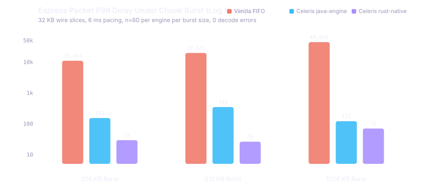

# Celeris

Single-jar, server-side Netty transport and Rust JNI engine for Minecraft (`1.20.5`–`1.21.x` & `26.1`–`26.x`).

Supports **Paper, Spigot, Purpur, Folia, Velocity, Fabric, and NeoForge**. Vanilla clients connect on `25565` with zero client mods.

- **Website & Live Benchmarks:** https://celeris.fy2ne.me
- **Modrinth:** https://modrinth.com/project/celeris_mc
- **Current Release:** `0.1.0-beta`

## What Celeris Fixes

On high-RTT or wireless connections, Minecraft servers burst 200–1,024 KB of chunks behind a single TCP FIFO socket buffer. Small `KeepAlive` pings, PvP hits, and knockback get trapped behind chunk transfers in the OS kernel queue, turning an 80 ms fiber connection into 150–1,000 ms spikes.

Celeris replaces the outbound packet framing/compression/scheduling path on the server with a per-channel Rust engine (and pure-Java fallback):

1. **Kernel Socket Tuning (`TCP_NOTSENT_LOWAT`, `BBR`, `TCP_QUICKACK`):** Clamps unsent kernel send backlog to `16 KB` and polls `TCP_INFO` smoothed RTT/variance directly from Linux.
2. **Bundle-Safe Priority Preemption:** Splits outbound packets into an ordered **Express Lane** (`KeepAlive`, `Ping`/`Pong`, combat hits, entity motion, blocks, atomic `BundleDelimiter` trains), **Ordering Barriers** (`ChunkBatchStart`/`Finished`, `FinishConfiguration`, `ForgetLevelChunk`), and a **Bulk Lane** (chunks, light updates, recipes). Express packets preempt queued chunk bursts while never splitting an active bundle or bypassing ViaVersion's encoder.
3. **Fused Single-Pass Off-Heap Codec:** Combines VarInt framing and zlib compression in one Rust pass, reducing Netty `ByteBuf` churn and GC pauses.

## Verified `v0.2.0` Benchmarks

Full charts, CSVs, and methodology live in [docs/benchmarks/FIELD_REPORT.md](docs/benchmarks/FIELD_REPORT.md) and [docs/benchmarks/benchmark_report.html](docs/benchmarks/benchmark_report.html).

| Scenario | Baseline FIFO | Celeris `java-engine` | Celeris `rust-native` |
|---|---:|---:|---:|
| **1 MB Burst Express P99 (32 KB paced)** | `44,390 us` | `130 us` | `100 us` |
| **TCP Loopback 1 MB Burst KA P95** | `15.25 ms` | `3.17 ms` | `2.70 ms` |
| **TCP Loopback 1 MB Burst KA P50** | `13.07 ms` | `0.81 ms` | `0.82 ms` |
| **Compression @ 256 B L6** | — | `76.2%` saved | `76.8%` saved |

- **Protocol Parity:** `0` decode errors across 540 burst-scheduler runs, 297 TCP loopback runs, and AES-128-CFB8 sweeps.
- **Live Paper `26.3` (`roxaura.mcsh.gg`, `v0.1.0` `java-engine`):** `78.7%` aggregate wire savings across `8,447` telemetry rows with `20,629` preempted Express packets and `0` disconnects.



## Commands

- `/celeris stats` — live active channels, Express/Bulk/preempted/backpressure/bypassed counts, Express queue delay percentiles (`P50`/`P95`/`P99`/`Max` in `us`), bulk hold time, compression savings, kernel RTT, and socket flags
- `/celeris bench [kb] [iters]` — run live in-JVM A/B benchmark (Baseline FIFO vs active Celeris engine)
- `/celeris debug` — inspect injected Netty pipelines, compression threshold sync, and ViaVersion handler ordering
- `/celeris test` — run synthetic 64 KB burst preemption self-test
- `/celeris ping [player]` — check `mcPing`, `kernelRtt`, and Express `P99`
- `/celeris toggle` — switch Celeris active vs zero-overhead bypass at runtime
- `/celeris lowat <bytes>` — adjust `TCP_NOTSENT_LOWAT` cap across live and new connections (default `16384`)
- `/celeris level <0-9>` — adjust zlib compression level across live and new connections (default `6`)
- `/celeris bulk <bytes|0>` — cap per-flush bulk burst bytes (`0` = automatic `TCP_INFO` pacing)

## Maven / Gradle (GitHub Packages)

```kotlin
repositories {
    maven("https://maven.pkg.github.com/fy2ne/Celeris")
}

dependencies {
    compileOnly("dev.fy2ne:celeris:0.1.0-beta")
}
```

## Building from Source

```bash
cd rust-core
cargo test --release
cargo build --release
cd ..

gradle :universal-jar:test :universal-jar:jar
```

The universal jar is written to `universal-jar/build/libs/Celeris-0.1.0-beta.jar`.

## Contributing & Security

- Read [CONTRIBUTING.md](CONTRIBUTING.md) before opening a PR (`/claim` gives a 7-day issue lease; PRs are capped at 500 added lines and must link an issue).
- Report security issues privately via [SECURITY.md](SECURITY.md).

## License

Licensed under **AGPL-3.0-or-later**. See [LICENSE](LICENSE).
