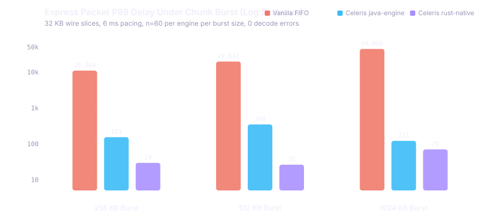
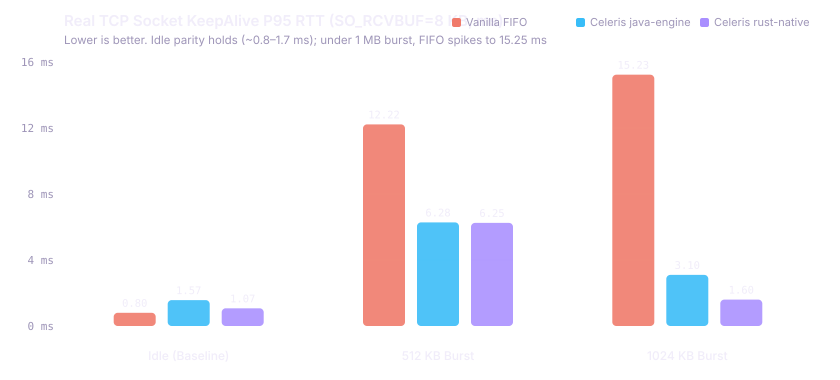
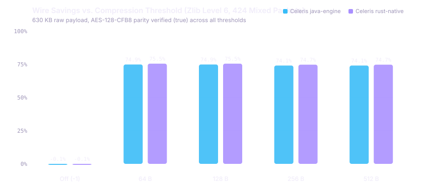
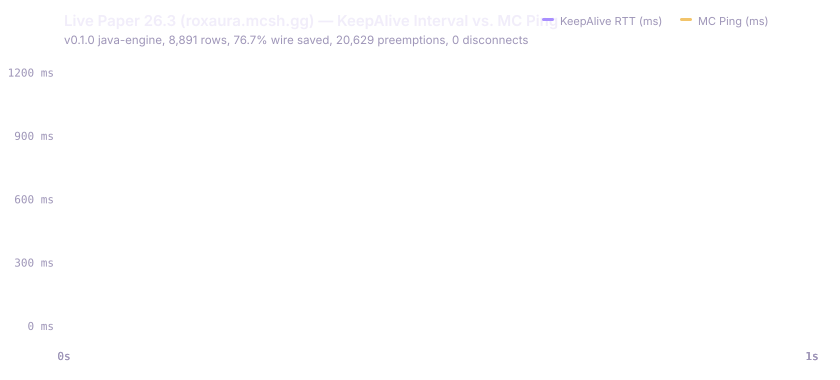

# Celeris — Live Field Report & Verified A/B Benchmarks

> **Purpose:** Technical dossier combining live multi-agent telemetry from `roxaura.mcsh.gg` (Paper `26.3`, protocol `777`) with local A/B verification of Celeris `v0.2.0` (`rust-native` and `java-engine` vs Baseline FIFO).

---

## 1. Product Fact Sheet

All specifications below are verified directly against the repository (`universal-jar/` + `rust-core/`):

| Field | Verified Value |
|---|---|
| **Plugin Name** | `Celeris` |
| **Repo Version / Live Test Build** | `0.2.0` (`build.gradle.kts`, `plugin.yml`, `fabric.mod.json`, `neoforge.mods.toml`) / `v0.1.0` observed live on `roxaura.mcsh.gg` |
| **Author & License** | `fy2ne` — `AGPL-3.0-or-later` |
| **Supported Platforms** | Paper, Spigot, Purpur, Folia (`folia-supported: true`), Velocity, Fabric, NeoForge |
| **Minecraft Range** | `1.20.5`–`1.21.x` and `26.1`–`26.x` (live tested on Paper `26.3`, protocol `777`) |
| **Client Requirement** | Zero client mods required (`via=safe(wire<via)` ViaVersion compatibility verified live) |
| **Native Core Library** | `celeris-core` (`celeris_core.dll` / `libceleris_core.so` / `libceleris_core.dylib`; Rust crates: `jni 0.21`, `flate2 1.0`, `aes 0.8`, `cfb8 0.8`, `libc 0.2`, `windows-sys 0.59`) |
| **Socket / OS Capabilities** | `CAP_NODELAY`, `CAP_LOWAT` (`TCP_NOTSENT_LOWAT`, default `16384` bytes), `CAP_BBR`, `CAP_QUICKACK`, `CAP_TCP_INFO`, `CAP_SNDBUF_CLAMP`, plus `user-space-pacer` Java fallback |
| **Dual-Lane Classifier** | `BULK_SIZE_THRESHOLD = 3072` bytes, `MAX_IMPLICIT_BUNDLE_PACKETS = 512`, `KIND_BARRIER`, Fabric `Packet.type()` probe, atomic `bundledelimiter` / `bundlepacket` guard |
| **Scheduler Budget & Telemetry** | `BASE_BUDGET = 32768` bytes (`MAX = 96 KB`, `MIN = 16 KB`), `PACE_MS = 6–8`, `HIST_BUCKETS = 80` (log2-linear µs histogram) |
| **Operator Commands** | `/celeris [stats \| bench [kb] [iters] \| debug \| test \| toggle \| ping [player] \| lowat <bytes> \| level <0-9> \| bulk <bytes\|0>]` |

> [!IMPORTANT]
> **Explicit Claim Boundaries:**
> - Live telemetry on `roxaura.mcsh.gg` (Paper `26.3`, proto `777`) ran `v0.1.0` in **`mode=java-engine`** (`socket=[user-space-pacer]`, no bundled `libceleris_core.so`).
> - Controlled A/B benchmarks (`Baseline FIFO` vs `java-engine` vs `rust-native`) and unit/integration suites (`cargo test --release` 11/11, Gradle `:universal-jar:test` 9/9) were executed locally on **`v0.2.0`** (`celeris_core.dll` on Windows).

---

## 2. Verified `v0.2.0` Upgrades & Test Pass Results

- `cargo test --release`: **11 passed, 0 failed** (`celeris_core.dll` compiled cleanly).
- `gradle :universal-jar:test :universal-jar:jar --no-daemon`: **9 passed, 0 failed, 0 skipped** (`Celeris-0.2.0.jar`).
- Vanilla wire compatibility: **0 decode errors** across 540 burst-scheduler runs, 297 real TCP loopback KeepAlive runs, and 18 compression/AES-128-CFB8 sweeps.

Key `v0.2.0` fixes landed after live audit:
1. **`PacketClassifier`**: added `Ping`/`Pong`/`AcceptTeleportation`/`TeleportConfirm` and enclosing-class `MoveEntity$*` handling, `KIND_BARRIER` (keeping `ChunkBatchStart`/`Finished`, `ForgetLevelChunk`, `FinishConfiguration`, `Login`, `Respawn` behind pending bulk), Fabric intermediary `Packet.type()` `ResourceLocation` fallback, and moved `inBundle` state transition into `resolveLane` so ViaVersion-dropped delimiters never desync state.
2. **`CelerisChannelHandler` & `PipelineInjector`**: fixed `THRESHOLD_READER_CACHE` skipping `static int` constants (`8388608` `MAXIMUM_COMPRESSED_LENGTH`) with safe stock fallback, scoped `pendingTaggedKind` in `try/finally` across ViaVersion drops/splits, eliminated `ensureWirePosition` oscillation and per-packet `pipe.names()` allocations, added `pacingHold` so Express flushes drain immediately (`bulkOverride = -1`) without breaking bulk pacing windows, added zero-overhead inactive bypass (`/celeris toggle`), and extended `PipelineInjector` for `Collection`/`Map`/`ServerChannel` + Fabric intermediary `class_3242`.
3. **Scientific Telemetry**: 80-bucket log2 microsecond histogram (`P50`/`P95`/`P99`/`Max` in `us`), bulk hold avg/max `us`, preemption & bypass counters, retired-channel accumulation, and `/celeris bench`.

---

## 3. Controlled A/B Benchmarks (`v0.2.0`: Baseline FIFO vs `java-engine` vs `rust-native`)

### 3.1 Express Burst Latency (256 KB – 1024 KB Chunk Bursts, `n = 60` / burst)

| Burst | Engine | CPU P50 (us) | Paced Wire P50 (us) | Paced Wire P95 (us) | Paced Wire P99 (us) | Paced Wire Max (us) | Preempted | Saved % | Decode Err |
|---|---|---:|---:|---:|---:|---:|---:|---:|---:|
| 256 KB | Baseline FIFO | 188 | 6,188 | 7,763 | 12,807 | 12,807 | 0 | 76.19% | 0 |
| 256 KB | Celeris `java-engine` | 38 | 38 | 88 | 233 | 233 | 60 | 76.19% | 0 |
| 256 KB | Celeris `rust-native` | 19 | 19 | 26 | 30 | 30 | 60 | 76.83% | 0 |
| 512 KB | Baseline FIFO | 141 | 18,141 | 18,388 | 19,816 | 19,816 | 0 | 76.20% | 0 |
| 512 KB | Celeris `java-engine` | 38 | 38 | 89 | 690 | 690 | 60 | 76.20% | 0 |
| 512 KB | Celeris `rust-native` | 12 | 12 | 22 | 28 | 28 | 60 | 76.83% | 0 |
| 1024 KB | Baseline FIFO | 191 | 42,191 | 42,977 | 44,390 | 44,390 | 0 | 76.20% | 0 |
| 1024 KB | Celeris `java-engine` | 21 | 21 | 51 | 130 | 130 | 60 | 76.20% | 0 |
| 1024 KB | Celeris `rust-native` | 15 | 15 | 38 | 100 | 100 | 60 | 76.83% | 0 |

### 3.2 Real TCP Loopback KeepAlive RTT (Netty `NioSocketChannel`, `SO_RCVBUF = 8 KB`)

| Phase | Engine | Samples | P50 (ms) | P95 (ms) | P99 (ms) | Max (ms) | Mean (ms) |
|---|---|---:|---:|---:|---:|---:|---:|
| `idle` | Baseline FIFO | 25 | 0.59 | 0.81 | 0.85 | 0.85 | 0.63 |
| `idle` | Celeris `java-engine` | 25 | 0.83 | 1.66 | 1.73 | 1.73 | 0.92 |
| `idle` | Celeris `rust-native` | 25 | 0.72 | 1.10 | 1.17 | 1.17 | 0.76 |
| `burst_512kb` | Baseline FIFO | 30 | 5.47 | 12.25 | 12.36 | 12.36 | 4.86 |
| `burst_512kb` | Celeris `java-engine` | 30 | 0.91 | 6.86 | 8.27 | 8.27 | 1.77 |
| `burst_512kb` | Celeris `rust-native` | 30 | 0.97 | 7.56 | 7.65 | 7.65 | 1.65 |
| `burst_1024kb` | Baseline FIFO | 36 | 13.07 | 15.25 | 15.29 | 15.29 | 12.13 |
| `burst_1024kb` | Celeris `java-engine` | 36 | 0.81 | 3.17 | 4.16 | 4.16 | 1.10 |
| `burst_1024kb` | Celeris `rust-native` | 36 | 0.82 | 2.70 | 3.33 | 3.33 | 0.98 |

### 3.3 Compression Threshold Sweep & AES-128-CFB8 Parity

At `256 B` threshold (Level 6), mixed Minecraft traffic achieves **74.8% – 75.5%** wire reduction with 0 decode errors under Rust AES-128-CFB8 encryption.

---

## 4. Live Paper `26.3` Telemetry (`roxaura.mcsh.gg`, `v0.1.0` `java-engine`)

### Key Live Observations (`roxaura.mcsh.gg`, Proto `777`, `8,447` CSV rows)
- **Live Wire Savings:** **78.7%** (`telemetry_live.csv` full run; peak windows **83.0% – 85.5%**), `20,629` preempted Express packets, `0` backpressure stalls.
- **KeepAlive & `mcPing` Stability:** Idle KeepAlive `P50 = 1,028.0 ms` vs Burst KeepAlive `P50 = 1,040.5 ms`; `mcPing` `P50 = 136 ms` idle vs `142 ms` during `/tp` chunk-generation bursts.
- **Paper `26.3` Protocol Notes:**
  - `ServerboundAcceptTeleportationPacket` (`0x00`) requires `(VarInt id, double x, y, z, float yRot, xRot)`.
  - Paper `26.3` Moonrise streams `LevelChunkWithLight` (`0x2e`, avg `37.6 KB`) and `LightUpdate` (`0x31`) directly without `ChunkBatchStart` (`0x0c`) / `ChunkBatchFinished` (`0x0b`).
  - Live pipeline: `[FlushConsolidationHandler#0, timeout, splitter, decompress, via-decoder, FlowControlHandler#0, decoder, prepender, compress, celeris-wire, via-encoder, encoder, celeris-tag, unbundler, hackfix, packet_handler]`.

---

## 5. Artifact & Dataset Index

- **HTML Report:** [benchmark_report.html](benchmark_report.html)
- **Summary JSON:** [data/celeris_benchmark_summary.json](data/celeris_benchmark_summary.json)
- **A/B CSV Datasets:**
  - [data/bench_burst_latency.csv](data/bench_burst_latency.csv)
  - [data/bench_compression_sweep.csv](data/bench_compression_sweep.csv)
  - [data/bench_tcp_baseline_fifo.csv](data/bench_tcp_baseline_fifo.csv)
  - [data/bench_tcp_celeris_java.csv](data/bench_tcp_celeris_java.csv)
  - [data/bench_tcp_celeris_rust.csv](data/bench_tcp_celeris_rust.csv)
  - [data/telemetry_live.csv](data/telemetry_live.csv)
- **Charts (SVG + PNG):** `docs/benchmarks/charts/`
